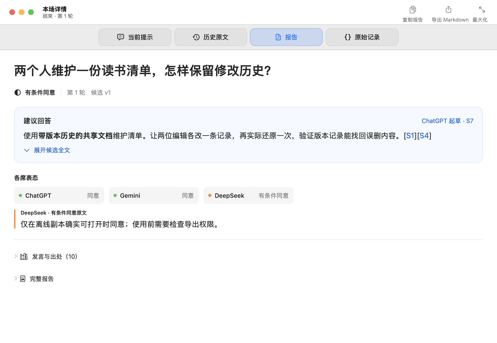

# AI Arena

AI Arena 是一个 **macOS 原生多模型讨论工作台**。输入一次问题，让 ChatGPT、Gemini 和 DeepSeek 在同一个窗口里独立作答、交叉互评，再对同一版候选结论逐席表态。



## 主要功能

- **两席或三席讨论**。各席使用独立的原站网页。工作台安排独立作答、互评、候选起草和逐席确认。
- **支持单席接管**。状态用固定类别标明，具体原因放在第二行或悬停说明。遇到登录、限流或网页变动，可以核对本轮提示、补录已有回答，或跳过这一席；补录面板不遮挡原页。
- **结论可追溯**。报告先显示候选与各席态度，再提供反例、未决分歧和发言出处。全体一致需要各席明确接受同一版本。
- **本机历史和导出**。可复制报告或导出 Markdown；历史可回看已完成场次，未完成场次在新建、关闭或退出后可从历史选择「继续这一场」。新建、结束或关闭窗口前会确认：结束整场后不能继续，关闭或退出确认后不再发起新的发送。

[查看讨论界面（本地测试样例）](docs/evidence/native-0.3/discussion.png)

## 从源码运行

需要 macOS 13 或更新版本、Apple Swift 工具链（Xcode 或 Command Line Tools）和 Node.js。现有实测使用 Apple Silicon。

```sh
git clone https://github.com/zhouchangju/ai-arena.git
cd ai-arena
./desktop/build.sh
open "desktop/build/AI Arena.app"
```

首次打开后，在应用内按站点提示登录。选两席或三席，输入问题，点「开始讨论」。完成后从「详情」查看原文和报告，或用「导出」保存为 Markdown。 [试用指引](docs/try-it.md)

各站点自行渲染网页，登录和自动收发受账号状态、站点页面及使用条款影响。参与席会收到题面，互评和确认时还会收到相关席位的发言和候选正文。讨论记录默认保存在 `~/Library/Application Support/AI Arena/`，网页账号由应用的 WebKit 数据存储维护。 [站点验证](docs/provider-validation.md)

## 文档

| 内容 | 入口 |
| --- | --- |
| 构建、签名、故障处理和验收命令 | [桌面版开发与排障](desktop/README.md) |
| 产品范围与工程实现 | [产品设计](docs/product-design.md) · [技术设计](docs/technical-design.md) |
| 真实站点与本地回归记录 | [迭代记录](docs/iterations.md) |
| Arena 与 Panelize 的早期调研 | [参考项目分析](docs/reference-review.md) |

## 开发与反馈

`desktop/` 包含 SwiftUI、WebKit 和构建入口。`extension/` 保留早期 Chrome 扩展，桌面构建从这里打包共享的讨论引擎和站点驱动。扩展的工具栏入口复用已打开的工作台标签页；`tabs` 权限下只按本扩展 `workspace.html` 地址做筛选查询，并只读取本席绑定标签页的地址，不读取页面内容。`tests/` 包含引擎测试及桌面版隔离验收。 [开发约定](AGENTS.md)

反馈站点问题时，请附上应用版本、macOS 版本、站点、界面语言和复现步骤。使用合成题面，移除账号信息、私有对话和登录凭据。 [GitHub Issues](https://github.com/zhouchangju/ai-arena/issues)

## 许可

本仓库目前尚未声明项目级许可证。TODO（项目所有者）　选择项目许可证。 [扩展内第三方品牌素材说明](extension/assets/providers/NOTICE.md)
