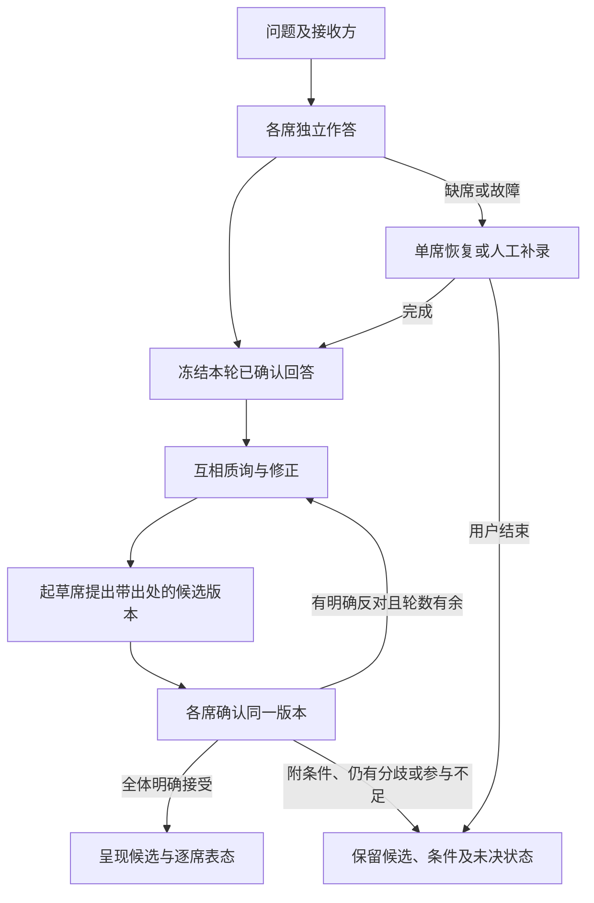

# 多 AI 辩论工作台技术方案

采用 Manifest V3 扩展。用户在独立的扩展标签页阅读和控制讨论，每位 AI 在自己的普通网页标签中工作。轮次调度与站点读写分开，网站改版时只更换对应适配器。扩展负责可靠传递材料、定位发言、恢复待办和呈现报告，独立作答、质疑、起草、修订与实质判断由参与讨论的模型完成。

## 参考实现怎样运行

| 环节 | Arena 5.0.75 | Panelize 2.2.4 |
|---|---|---|
| 发起 | 侧栏广播由后台分发；群聊走 ChatBus，辩论按钮走后台轮次处理器。两条发送路径的状态及重试语义要分别读。 | 扩展后台打开或聚焦 multi-panel，主页面管理 iframe 数组、统一输入、布局、草稿及广播锁。 |
| 页面连接 | 后台管理参与者和原页标签，内容脚本读写页面。每站有输入、发送、回答与流式状态的定位逻辑。 | 网页面板与主界面交换带上下文的消息。原生网页和扩展自身的 API 面板可出现在同一网格。 |
| 内容传递 | 群聊轮询按成员服务读取进展，界面与本地日志收到更新。每轮从已收集答案构造给其他成员的提示，再送指定裁判。 | 统一输入广播到多个面板，动作回执用于确认特定操作；原网页直接给用户展示回复。API 面板另行处理流式输出。 |
| 持久化 | 本地保存成员、轮次、最近发送与已接受文本、待总结任务；历史日志和视图偏好另有保存。不同轮龄的长答可按预算截断。 | 设置部分使用浏览器 sync，提示库及可选 API 密钥有独立的 IndexedDB 存储；后台可暂存待面板打开后处理的操作。 |
| 失效恢复 | 重读、补发、重开标签、重新检测登录；后台醒来可恢复近期的待收集任务。不同打包变体允许的能力有所不同。 | 找不到控件、超时或权限撤回按席反馈；嵌入兼容、原位移动标签和失败面板重试分别处理。 |

这两套实现的可复用边界是独立模块和测试材料。直接 fork Arena 能最快看到现成的群聊与九个站点入口，但保留了多个发送入口、整套附属功能以及按服务标识归属的旧逻辑。若目标变成原样维护上游，这个取舍值得重评。当前选择在空仓库新建协调器，按需迁入经过验证的小模块；以 Panelize 整包为底会额外承担嵌入网页的维护工作。

自用版沿用参考 Arena 的分席标签、网页正文轮询和局部界面更新。站点适配器定义输入、发送、用户消息、回答和生成状态的定位逻辑。任务先保存发送意图，再核对原页出现的本轮用户消息。实时正文只作为预览；每席的完整正文单独归入本轮。手动接管对该席生效，其他席仍可读取和提交。

### 在一个工作台观察各席

参考 Arena 的群聊路径先在浏览器打开站点标签，然后读回正文，通过 `chatStreamUpdate` 更新群聊。群聊代码里用于摘要的 iframe 承载生成的 HTML。Panelize 的网页面板使用 iframe，并有独立的站点嵌入兼容逻辑。 [Arena 打开标签](../../ai-arena-extension/src/background.js) · [Arena 群聊读取](../../ai-arena-extension/src/chat-bus.js) · [Panelize iframe 消息协议](../../Panelize/modules/panel-message-contract.js)

本轮公开入口检查发现 Gemini 返回 `X-Frame-Options: DENY`，ChatGPT 的 `frame-ancestors` 只允许自身和列出的扩展来源，DeepSeek 请求返回 429，无法判断其嵌入策略。工作台继续由各站普通标签收发，在同一页并排显示准备发送或已核对的提示、网页正文和发送状态。点「打开原页」可查看实际网站界面及控件。 [浏览器嵌入规则](https://developer.mozilla.org/en-US/docs/Web/HTTP/Reference/Headers/Content-Security-Policy/frame-ancestors)

## 核心流程与工程边界

| 拟建目录 | 职责与接口 | 可单独验证的结果 |
|---|---|---|
| `src/debate/` | 纯 TypeScript，给定会话、冻结材料、事件和轮次上限，安排提示、收件人和下一步。根据同版表态计算流程状态，以本地模板呈现模型原文、出处和状态。 | 用同一批回答回放可重复得到相同的状态转移及收件人。修订后的候选需重新确认。 |
| `src/extension/` | MV3 后台是状态写入方，协调标签、持久化命令、回执与恢复；扩展随包加载，不依赖自有云服务。 | 结束后台进程后，重新打开工作台可重建待办。 |
| `src/providers/` | 每站一份域名及能力描述、一套页面读写逻辑。人工粘贴和测试驱动也实现相同的回答交付接口。 | 改一个站点不会变更轮次代码；账号或界面差异能降级到单席接管。 |
| `src/workspace/` | 提问、成员、进度、并排比较、历史、引用、报告。只提交命令并读取持久化状态及增量更新。 | 两个工作台窗口看到同一状态，重复点击不会创建第二轮。 |
| `tests/fixtures/`、`tests/browser/`、`tests/live/` | 分别保存合成或脱敏样本、浏览器回归、单站真实烟测。 | 本地可重复回放，实站有独立的日期、页面条件和结果。 |

扩展程序只在本场绑定、已授权的来源上读写网页。网页权限按站申请，内容脚本优先运行于隔离环境；报告用安全的文本或受限 Markdown 呈现。原页登录态由浏览器维护。持久化是必要条件，Chrome 官方记录扩展后台通常在空闲 30 秒后可被终止。[内容脚本文档](https://developer.chrome.com/docs/extensions/develop/concepts/content-scripts) · [后台生命周期](https://developer.chrome.com/docs/extensions/develop/concepts/service-workers/lifecycle)

## 数据与消息

| 本地实体 | 应保存的事实 |
|---|---|
| 讨论 | 题面、用户判断标准、原始名单、各席站点与可识别的模型名、策略版本、当前阶段、轮数上限、停止原因。 |
| 轮次 | 阶段、参与名单、上下文版本、用户新增条件、冻结的输入发言 ID。加入或移除成员只对后续轮次生效。 |
| 投递 | 讨论、轮、接收者、任务号、实际提示全文及摘要、绑定的标签与对话标识、提交前页面基线、状态与最后事件号。 |
| 发言 | 每次生成或人工补录的原文、来源方式、完成证据、轮次及段落编号；用户编辑创建派生版本。 |
| 争点 | 具体命题、支持与反对发言、影响结论的条件、处理状态。转述带回原段落，早期异议一直保留到解决或列入报告。 |
| 候选结论及报告 | 起草席、候选原文、版本和正文校验值、逐席态度及所附条件、来源编号、缺席名单和停止原因。报告按版本及正文校验值关联表态。修订后旧确认留作历史。 |

讨论、投递、发言、版本放在扩展源 IndexedDB；同一事务内保存关键状态和下一步待办。少量界面偏好放在本地扩展存储。存储失败时暂停待发动作，在工作台显示可导出和释放空间的选项。问题、网页回答和登录信息不写入诊断包。删除一场仅影响扩展本机记录，原站历史服从各站自身设置。

适配器应能分别报告“可填写、可提交、可读本轮、可判断完成”。调度器传入投递号、站点会话和输入基线，收到带投递号的“已填入”“看到本轮用户消息”“回答增量”“已完整结束”或故障。后台核对浏览器提供的标签、来源、文档实例和任务版本。刷新页面要重新绑定；SPA 从新建页跳到对话页时，先核对本轮用户消息再接受新对话标识。

## 三个容易做错的地方

**一次提交发生在网页端，事务发生在扩展端。** 两者之间可能断线。派发前先记录意图与任务号，同一投递只允许一个执行者；拿到填写回执还需观察用户消息。若发送后后台重启，先核对原页；能匹配就恢复监听，明确未提交才允许重试。无法识别时展示“发送结果待确认”，用户可核对或补录。没有网站提供的幂等接口时，不能保证跨崩溃精确一次。

**网页暂时不动，也可能还在回答。** 绑定本轮新增的用户消息和后续助手消息，综合站点终止标志与正文稳定状态。被截断、限流、页面换会话、纯回显、读到上一轮都单独记录。完整答复可进入冻结材料，超时片段只进草稿。迟到的回答仍归原轮，若用户已跳过该席，重新纳入需要创建新版本。

**表态必须绑定候选全文。** 每轮把他方发言作为带来源的数据，要求模型回应具体反例和成立条件。起草席返回候选正文，工作台检查 `[S#]` 能否定位到本场已保存的发言，并按候选版本、正文校验值和明确表态计算状态。报告保留参与模型给出的条件和异议。引文与主张是否匹配、事实是否成立，由阅读者结合原文和外部证据判断。

## 网页接入的现实边界

Chrome 能读 DOM，并不代表每家消费版网页都许可程序化收发。查到的 OpenAI 个人条款明确限制自动或程序化提取输出；Anthropic 所展示的消费者条款限制未经明确允许的自动访问；DeepSeek 中文协议也列有对自动抓取的限制。实际账号、地区、授权及服务版本分别核对。这会影响每席可开放的操作。对受限能力提供“复制任务、打开原页、粘贴回答”；对本人控制并获准自动操作的网页可用完整驱动。用户自己按一次开始，也不自动改变站点允许的能力。[OpenAI 个人条款](https://openai.com/policies/terms-of-use/) · [Anthropic 消费者条款](https://www.anthropic.com/legal/consumer-terms) · [DeepSeek 用户协议](https://cdn.deepseek.com/policies/zh-CN/deepseek-terms-of-use.html)

第一组实测选用户常用的两个真实服务，同时记录自动与人工步骤；没有已经确认可全自动的消费站点组合。若两席都需要手工转交，应如实计入操作成本。另可在允许自动操作的自建网页用两个不同模型完整测试编排，覆盖全自动路径；此结果不能替代两个目标官网的验证。若个人实测显示手工成本超过节省的时间，才考虑增加官方 API 席位，保留网页席位混用。单场交互成本可预估：两席独立作答 2 次、一轮互评 2 次、提案 1 次、各席表态 2 次，共 7 次网页请求；最终报告可由本地模板生成。

## 从需求落到实现和验证

| 需求 | 对应参考项 | 实现落点 | 要留下的验收证据 |
|---|---|---|---|
| R01 建场 | A01–A05、P01、P08 | 工作台收集题面与名单，后台创建场次和两份独立会话绑定。 | 首次使用录屏，拒绝某一站权限时的界面和两份实际题面。 |
| R02 独立回答 | A07、A10、A11、P04、P13 | 首轮任务共享同一题面快照，按投递号保存结果。 | A 先于 B 返回的事件记录、B 实际收到的提示及原页回答。 |
| R03 质询 | A14–A17 | 同一批回答冻结后按收件人组装；原文保留，材料过长时优先保留未决反例及出处。 | 双方收到的完整提示、被质疑段落、修正前后两份主张。 |
| R04 收敛 | A15、A20 提供轮次和裁判；逐席确认是新增 | 候选正文、版本与参与名单绑定。全体一致要求所有席位完整参与并明确接受同一候选全文。 | 含赞成、缺席、附条件、反对、旧版本同意五组独立回放。 |
| R05 报告 | A13、A20、A22 | 本地模板呈现模型候选和按版本归属的逐席表态，保留用于追溯反例和回应的发言。 | 候选引用不存在的 `[S#]` 时拒绝提交，有效编号可点到原文。核对完整参与但候选无编号时的草稿状态，以及界面和 Markdown 对同一候选版本的呈现。 |
| R06 进度与恢复 | A05、A12、A27、A28、A33、P05、P12、P13 | 写前记录、站点对账、任务级暂停和人工补录；诊断只记步骤和错误类别。 | 服务工作线程重启、回执迟到、撤权、人工补录、跳过的事件序列与原页发送次数。 |
| R07 阅读与历史 | A12、A13、A22、A23、P02、P03 | 固定场次/轮次编号驱动历史和并排视图；Markdown 导出直接读取保存的记录。 | 两场同题历史检索、跨轮引用跳转及离线导出样本。 |
| R08 私人使用 | A26、A30–A32、P14、P18、P20–P22 | 检查实际出站文本，退出上游推广、店铺及水印逻辑；诊断、设置和原文分开保存。 | 安装包资产列表、界面及导出样本、仅统计扩展主动发起的域名清单。 |
| R09 站点能力 | A04、A29、P07、P08、P10、P23 | 注册表按动作存能力和验证时间；可用性不足时仅降级一个成员。 | [逐站记录](provider-validation.md)，含回放、实站、手动操作和未测维度。 |

**后续模块的接入位置。** 顺序接力和角色分工进入轮次策略（A18、A19）；接棒简报和个人模板是从已冻结材料生成新草稿（A21、A24、P16）。附件按接收者记录实际收到的文件清单（A09、P06）；摘录与选区导入保存来源，须经草稿再分享（A08、A25、P15）。截图、离线 HTML、列宽和 Mini Bar 只消费阅读视图（A06、A22、P03、P17）。以后如启用 API 席位，使用独立传输适配器，复用同一套发言、质询和报告逻辑（P11）。每项启用前执行对应功能条目的参照复核与自用版验证。

## 开发批次与退出条件

1. **先验证读写边界。** 用本机受控测试页模拟两种编辑器和流式回答；测试一次真实服务交接，登记登录、语言、布局、是否手动及卡住环节。完成条件是两位不同成员的实答能可靠进入各自轮次，任何样本站仅算样本通过。
2. **跑通双席讨论。** 首问、一次互评、带编号的候选、独立表态、本地报告。回放全体接受和明确反对两种结局。两个真实网页能走到报告且接管点明确，才算网页闭环；两页均自动时才能标注“全自动”。
3. **补齐故障和无推广验收。** 逐项执行 [R01–R09](product-design.md)、[功能清单 A](arena-features.md)、[功能清单 P](panelize-features.md) 中标为首版、改造或排除的对应部分。对慢响应、改版、重复请求、休眠、二次打开及删除场次留证，检查发布包、界面、导出与网络。
4. **复验编排与报告。** 检查实际提示、答复及出处是否逐席对得上，当前版本的表态和未决分歧是否可查，单席接管及关闭重开能否恢复。分别登记夹具和真实账号证据。后续清单里的可选能力按实际使用需要决定。
