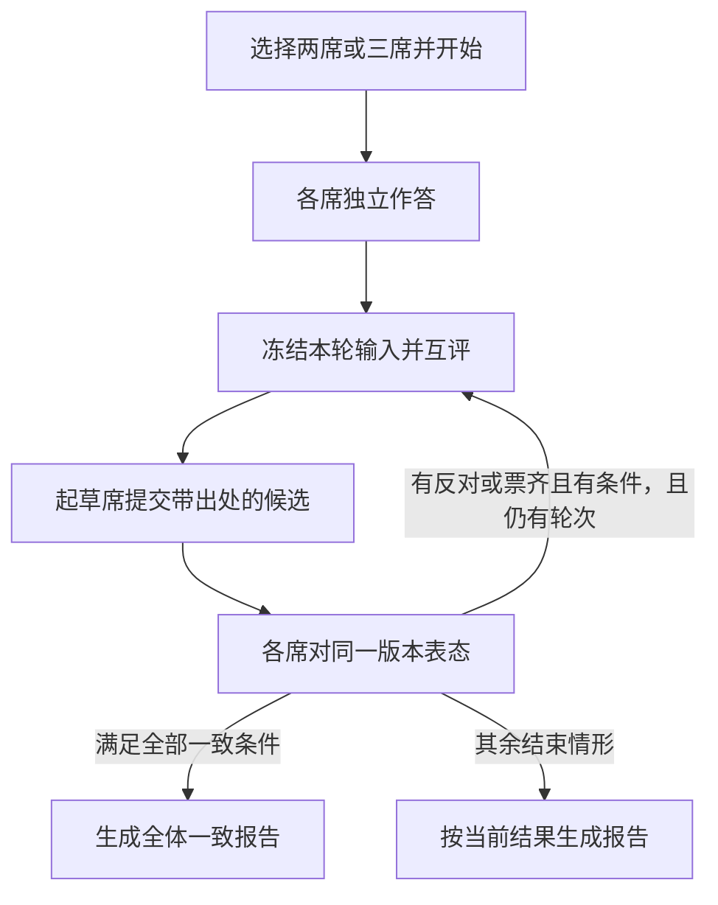

# macOS 工作台技术设计

AI Arena 使用 SwiftUI 构建工作台，通过 WebKit 在独立席位中加载各站的真实网页。Swift 调度器管理投递、接管和恢复。本地 JavaScriptCore 引擎管理轮次、候选版本、表态和报告。参与讨论的网页模型负责生成回答与判断。

## 组件

| 组件 | 当前职责 |
| --- | --- |
| [ArenaApp.swift](../desktop/ArenaApp.swift) | 开场、席位、进度、历史和手动接管。 |
| [ArenaAttachmentComposer.swift](../desktop/ArenaAttachmentComposer.swift) | 接收多项粘贴、文件拖入和普通文字，显示附件缩略图与预览。 |
| [SitePane.swift](../desktop/SitePane.swift) | 包装 WKWebView，绑定站点与对话，调用网页驱动并核对本轮回读。原站负责渲染流式正文、图片和网页交互。 |
| [ArenaModel.swift](../desktop/ArenaModel.swift) | 调度各席任务，处理暂停、发出后待确认、单席接管和重启恢复。 |
| [ArenaEngine.swift](../desktop/ArenaEngine.swift) | 桥接 JavaScriptCore，装入站点配置，管理本地场次文件。 |
| [core.js](../shared/core.js) | 共享讨论状态机，构造轮次提示、绑定候选和表态、生成报告。 |
| [web-driver.js](../shared/web-driver.js) · [provider-web-configs.js](../shared/provider-web-configs.js) | 查找站点编辑器、发送控件、本轮消息和结束信号。桌面构建打包 ChatGPT、Gemini、DeepSeek 的配置。 |
| [ArenaReportReader.swift](../desktop/ArenaReportReader.swift) · [ArenaMarkdownView.swift](../desktop/ArenaMarkdownView.swift) | 报告窗口、出处导航和 Markdown 阅读。 |
| [build.sh](../desktop/build.sh) | 打包 Swift 可执行文件、共享 JavaScript 与站点配置，生成本地签名的应用包。 |

## 一场讨论如何推进

[查看完整流程图](discussion-flow.html)，包含续评条件、全体一致判定和单席接管。

带图的首轮先将图片交给原页并核对顺序，再提交题面。站点预览缺少文件名时，驱动可用已解码图像的像素摘要核对身份。摘要随发送意图保存，重启核对时可继续使用。发送后核对本轮用户消息内的图片。缺图、错序或身份无法确认会停在该席等待处理。

每个投递先保存任务及发送意图。网页驱动填入实际提示、尝试提交，并核对同一会话中出现的本轮用户消息。读取答复时绑定该消息之后的助手回复，结合各站结束信号判断完成。流式预览可先显示，确认完成后才提交给讨论引擎。

站点提交与本地保存是两个步骤。发送结果不明时，应用优先回到绑定的对话核对实际提问与后续回复。普通重启后，仍有待处理任务的场次先进入人工核对。单席接管或跳过时，其余席位可以继续。

互评提示带来源编号，候选原文与版本及正文校验值绑定。修订后重新征求各席表态，旧版本记录继续可查。缺席、无法解析的表态及附加条件均有对应状态。报告引用定位到本场已保存的发言，阅读者可以用原文核对模型的转述和主张。

## 界面状态与破坏性操作

每席状态由模型发布的结构化类别（待发送、生成中、已收到、需要你处理、已接管、已跳过、已暂停、已完成）和一条原因文本组成。界面只按类别决定颜色与短标签，原因放在第二行或悬停说明；导出的状态从保存的场次推导，避免把只读回看等临时界面状态写进报告。

新建、结束、跳过本席以及运行中关闭窗口或退出应用都要先确认。结束会结束整场，已完成场次之后只能回看、不能继续；关闭窗口或退出确认后不再发起新的发送，已经发送的请求仍可能在原站生成。未完成场次可在新建、关闭或退出后从历史选择「继续这一场」，走与命令行续跑相同的只读核对路径。接管只切换状态，补录面板保持非模态并优先预填已保存回答，没有时使用最新流式预览并标注部分预览。原页的 JavaScript 确认框以窗口内表单呈现，不阻塞其他席位；需要回调的登录弹窗使用独立子窗口。

Markdown 导出的场次编号只出现一次，时间使用本机时区并带偏移。窄窗口下三席保持整列全高并横向滚动，不压成两行半高页面。

## 本地状态与站点边界

- 场次、发言、待办、发送意图和接管状态存为本机 JSON。默认目录为 `~/Library/Application Support/AI Arena/`，场次文件采用原子替换。
- 开场附件按场次保存本机副本，JSON 保存文件名、格式、字节数、SHA-256 和顺序。首轮任务引用场内附件。文本文件正文编入实际提示，图片交给席位原页上传。后续互评使用同一对话。旧场次可按无附件读取。
- 应用的持久 WebKit 数据存储管理网页登录会话。QA 应用使用独立标识和临时场次目录，验收请求指向本地回环夹具。
- 题面、首轮附件及后续轮次所需的原文会送到所选网页站点。网站可用性和自动操作权限需要按站点、账号与使用条件确认。 [站点验证](provider-validation.md)

## 需求与验收

| 需求 | 验收时核对 |
| --- | --- |
| R01–R02 建场、独立回答 | 两席和三席均能开场。逐席核对同一题面、文本附件正文、图片顺序和首轮回执，检查独立作答材料中没有其他席答案。 |
| R03–R04 互评、收敛 | 对照冻结材料和实际提示。检查反对后修订、同版重投、附条件与缺席。 |
| R05 报告 | 点击来源编号能找到正确席位和轮次。报告和导出对应同一候选版本。 |
| R06 进度、接管与恢复 | 覆盖发送结果不明、慢响应、接管补录和中途重启。对照原页的发送次数。 |
| R07–R08 历史与私人使用 | 重开后检查已保存的原文、历史和导出。核对出站内容及接收席位。 |
| R09 站点能力 | 独立记录真实站点条件与夹具回归结果。 [逐站记录](provider-validation.md) |

[产品需求](product-design.md) · [桌面版验收命令](../desktop/README.md#构建和验收) · [迭代记录](iterations.md)

## 早期实现与参考

早期 Manifest V3 工作台使用浏览器标签与 IndexedDB，源码与验收夹具保存在 Git 标签 extension-final。桌面应用从 `shared/` 打包讨论状态机、网页驱动及站点配置。

[Arena 与 Panelize 源码调研](reference-review.md) · [早期技术设计](https://github.com/zhouchangju/ai-arena/blob/3c81073aefdd9e712e002aa35ad74acf7be00da9/docs/technical-design.md)
